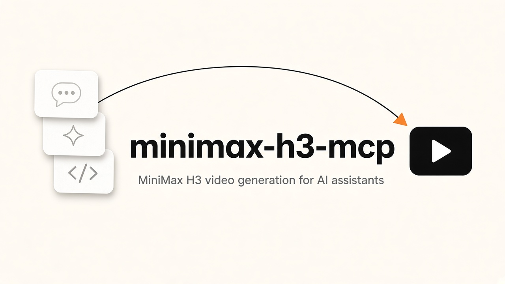

# MiniMax H3 MCP

MiniMax H3 video generation for AI assistants

This lets AI assistants in chat apps and code editors make short videos from a text description, using MiniMax H3. You type something like "make a 5 second video of a lake at sunrise" and the assistant gives you back a video. It is for anyone who wants that video step in an assistant they already use. You need your own MiniMax API key. MCP is a standard plug that lets AI assistants use outside tools.

stdio MCP server for **MiniMax-H3** and **MiniMax-H3-Max** video generation. It talks only to the official MiniMax V2 endpoints. It does not wrap or replace the Hailuo `minimax-mcp` package (T2V-01 / I2V-01).

`minimax_h3_create_video` starts a paid pay-as-you-go job. Only call it when you intend to generate a clip. Unit tests mock HTTP and never hit the live API.

Official docs:

- Create: https://platform.minimax.io/docs/api-reference/video-generation-v2-create
- Query: https://platform.minimax.io/docs/api-reference/video-generation-v2-query
- Host: `https://api.minimax.io` (override with `MINIMAX_API_HOST`)

```
POST /v2/video_generation
Authorization: Bearer $MINIMAX_API_KEY
Content-Type: application/json
```

```
GET /v2/query/video_generation/{task_id}
```

Statuses: `queued` | `running` | `succeeded` | `failed` | `cancelled`.

On succeeded, `task.content.url` is time-limited. `minimax_h3_wait_for_video` downloads the mp4 to `MINIMAX_H3_OUTPUT_DIR` (default: `./minimax-h3-output` in the process working directory).

## Supported models and features

These are the models and constraints this server validates. They match the code in `minimax_h3/validation.py`.

| | MiniMax-H3 | MiniMax-H3-Max |
| --- | --- | --- |
| Modes | Text-to-video, image-to-video (first/last frame), reference-to-video | Text-to-video and image-to-video first/last only (no `reference_image` / `reference_video` / `reference_audio`) |
| resolution | `768P` \| `2K` | `480P` \| `768P` (no `2K`; default `768P`) |
| duration | 4-15 s | 5-15 s (4 is not allowed) |

### content[]

Must include one non-empty `text` (max 7000 characters).

- `type`: `text` | `image_url` | `video_url` | `audio_url`
- `image_url` / `video_url` / `audio_url`: `{ "url": "..." }`
- `role`: `first_frame` | `last_frame` | `reference_image` | `reference_video` | `reference_audio`

Image-to-video (`first_frame` / `last_frame`) and reference (`reference_*`) cannot be mixed.

Limits (documented and count-validated; remote clip duration is enforced by MiniMax):

- Image: first <= 1, last <= 1, `reference_image` <= 9; JPG/JPEG/PNG/WEBP/HEIC/HEIF; <= 30 MB
- Video (reference only): <= 3 clips, per-clip 2-15 s, total <= 15 s; <= 50 MB; mp4/mov
- Audio (reference only): <= 3 clips, per-clip 2-15 s, total <= 15 s; <= 15 MB; wav/mp3
- Total request body <= 64 MB

Public URLs, `mm_file://{file_id}`, and data URIs are accepted. Large files should use a URL (the request body limit still applies).

### Ratio

- Text-to-video (text only): `ratio` is required and cannot be `adaptive`
- Image-to-video: ratio is always adaptive (other values are ignored)
- Reference-to-video: ratio is optional, default `adaptive`
- Values: `adaptive` | `21:9` | `16:9` | `4:3` | `1:1` | `3:4` | `9:16`

Optional create field: `callback_url`.

## Requirements

- Python 3.10 or newer
- A MiniMax pay-as-you-go API key

## Install

```bash
git clone https://github.com/Matinrahimik/minimax-h3-mcp.git
cd minimax-h3-mcp
python3 -m venv .venv
.venv/bin/pip install -e .
```

For development (tests):

```bash
.venv/bin/pip install -e ".[dev]"
MINIMAX_H3_TEST_MODE=1 .venv/bin/python -m pytest
```

Copy `.env.example` to `.env` and fill in your key (`.env` is gitignored). `run.py` loads `.env` without overriding variables already in the environment.

## Environment variables

Get a pay-as-you-go API key at [MiniMax Platform](https://platform.minimax.io): sign in, then **Account > API Keys > Create new secret key**. Copy the key immediately. M Plan subscription keys are separate and are not interchangeable with pay-as-you-go keys.

| Variable | Required | Default | Purpose |
| --- | --- | --- | --- |
| `MINIMAX_API_KEY` | yes (for live calls) | (none) | Bearer token for `https://api.minimax.io` |
| `MINIMAX_API_HOST` | no | `https://api.minimax.io` | API host (no trailing slash needed) |
| `MINIMAX_H3_OUTPUT_DIR` | no | `./minimax-h3-output` (process cwd) | Where `minimax_h3_wait_for_video` writes `{task_id}.mp4` |
| `MINIMAX_API_KEY_FILE` | no | (none) | Path to `{"api_key":"..."}` JSON or a one-line key file |
| `MINIMAX_CONNECTOR_SECRETS_ROOT` | no | (none) | Directory of `{id}/minimax.json` files used as a fallback key store |
| `MINIMAX_AGENT_ID` | no | (none) | Subdirectory name under `MINIMAX_CONNECTOR_SECRETS_ROOT` |
| `MINIMAX_H3_TEST_MODE` | no | unset | Set to `1` to refuse live HTTP unless an httpx client is injected |

Lookup order for the API key: process env, `.env` next to `run.py`, `MINIMAX_API_KEY_FILE`, then `MINIMAX_CONNECTOR_SECRETS_ROOT` (agent id path, then any `*/minimax.json`).

`run.py` loads secrets into the environment, then execs the stdio server. It does not hardcode an agent id.

## MCP config

Replace `/absolute/path/to/minimax-h3-mcp` with the clone path on your machine. Prefer the venv interpreter so the `mcp` and `httpx` packages resolve.

### Cursor (`~/.cursor/mcp.json`)

```json
{
  "mcpServers": {
    "minimax-h3": {
      "command": "/absolute/path/to/minimax-h3-mcp/.venv/bin/python",
      "args": ["/absolute/path/to/minimax-h3-mcp/run.py"],
      "env": {
        "MINIMAX_API_KEY": "your-minimax-api-key"
      }
    }
  }
}
```

### Claude Desktop (`claude_desktop_config.json`)

```json
{
  "mcpServers": {
    "minimax-h3": {
      "command": "/absolute/path/to/minimax-h3-mcp/.venv/bin/python",
      "args": ["/absolute/path/to/minimax-h3-mcp/run.py"],
      "env": {
        "MINIMAX_API_KEY": "your-minimax-api-key"
      }
    }
  }
}
```

After `pip install -e .` you can also set `"command"` to `/absolute/path/to/minimax-h3-mcp/.venv/bin/minimax-h3` and omit `args`. That entry point still reads the same environment variables (and `.env` when present).

## Tools reference

### `minimax_h3_create_video`

Create a MiniMax H3 / H3-Max video generation task (`POST /v2/video_generation`). Paid. Rejects illegal model, mode, resolution, and duration combinations.

**Params**

| Name | Type | Required | Notes |
| --- | --- | --- | --- |
| `model` | `"MiniMax-H3"` \| `"MiniMax-H3-Max"` | yes | H3-Max does not allow reference-to-video |
| `content` | array of content items | yes | See content[] above |
| `resolution` | `"480P"` \| `"768P"` \| `"2K"` | yes | Valid values depend on `model` |
| `duration` | integer seconds | yes | H3: 4-15. H3-Max: 5-15 |
| `ratio` | `"adaptive"` \| `"21:9"` \| `"16:9"` \| `"4:3"` \| `"1:1"` \| `"3:4"` \| `"9:16"` | no | Required for text-to-video |
| `callback_url` | string | no | MiniMax task-status callback URL |

Each content item:

| Field | Type | Notes |
| --- | --- | --- |
| `type` | `"text"` \| `"image_url"` \| `"video_url"` \| `"audio_url"` | Required |
| `text` | string | Required when `type` is `text` |
| `image_url` | `{ "url": string }` | Required when `type` is `image_url` |
| `video_url` | `{ "url": string }` | Required when `type` is `video_url` |
| `audio_url` | `{ "url": string }` | Required when `type` is `audio_url` |
| `role` | `"first_frame"` \| `"last_frame"` \| `"reference_image"` \| `"reference_video"` \| `"reference_audio"` | Optional. Unroled images default to `first_frame` |

**Returns**

- Success: `{ "ok": true, "task_id": "<id>", ... }` (plus any other fields MiniMax includes on create)
- Failure: `{ "ok": false, "error": "<message>" }` (validation or HTTP). Messages never include the API key.

### `minimax_h3_get_task`

Query a MiniMax V2 video task (`GET /v2/query/video_generation/{task_id}`). Does not download the file.

**Params**

| Name | Type | Required | Notes |
| --- | --- | --- | --- |
| `task_id` | string | yes | Value returned by create |

**Returns**

Success object:

| Field | Meaning |
| --- | --- |
| `ok` | `true` |
| `task_id` | Task id |
| `status` | `queued` \| `running` \| `succeeded` \| `failed` \| `cancelled` |
| `model` | Model used |
| `resolution` | Output resolution |
| `duration` | Output duration in seconds |
| `ratio` | Output aspect ratio |
| `usage` | Usage object from MiniMax (`total_seconds`, `input_seconds`, `output_seconds`, `input_image_count`) |
| `url` | Time-limited `task.content.url` when succeeded, otherwise absent/empty |
| `error` | Task error object when MiniMax reports one |
| `task_type` | MiniMax task type |
| `modality` | MiniMax modality |
| `raw` | Full query JSON |

Failure: `{ "ok": false, "error": "<message>" }`.

### `minimax_h3_wait_for_video`

Poll a task about every 12 seconds until it is `succeeded`, `failed`, or `cancelled`. On succeeded, download the mp4 from `task.content.url`. Does not create a new paid job.

**Params**

| Name | Type | Required | Default | Notes |
| --- | --- | --- | --- | --- |
| `task_id` | string | yes | | Value returned by create |
| `poll_interval` | number | no | `12.0` | Seconds between queries |
| `timeout` | number | no | `1800.0` | Overall wait limit in seconds |

**Returns**

Same summary fields as `minimax_h3_get_task` (without `raw`), plus:

| Field | Meaning |
| --- | --- |
| `ok` | `true` |
| `path` | Local filesystem path of `{task_id}.mp4` under `MINIMAX_H3_OUTPUT_DIR` |

Failure: `{ "ok": false, "error": "<message>" }` (failed/cancelled task, missing URL, download error, or timeout).

## Usage example

After the server is connected in Cursor or Claude Desktop, ask the client to generate a short clip and wait for the file:

1. Call `minimax_h3_create_video` with `model=MiniMax-H3`, `content=[{"type":"text","text":"A boy playing basketball by the sea"}]`, `resolution=768P`, `duration=5`, `ratio=16:9`.
2. Read `task_id` from the result.
3. Call `minimax_h3_wait_for_video` with that `task_id`.
4. Open the returned `path` (an mp4 under `MINIMAX_H3_OUTPUT_DIR`).

To inspect status without downloading, call `minimax_h3_get_task` instead of wait.

## Tests

```bash
MINIMAX_H3_TEST_MODE=1 python -m pytest
```

HTTP is mocked. Tests never call paid generate.
